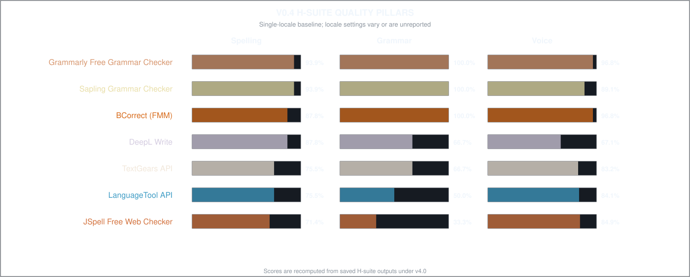

# Voice-Preserving Spellcheck Benchmark

We test how well spelling and grammar tools fix real mistakes without ruining
the writer's voice, tone, or meaning. Anyone can run these tests locally and
verify the results for themselves.

## Start here

- [How we score](#how-we-score)
- [Benchmark results](#results)
- [Our intent](#our-intent)
- [Next version (v0.5 draft)](#next-version-v05-draft)
- [Documentation index](documentation/README.md)

## How we score

The results below use the v0.4 scoring:

| Pillar | Weight | What it measures |
| --- | ---: | --- |
| Spelling | 43.75% | Did the tool fix the marked spelling mistakes? |
| Grammar | 31.25% | Did the tool fix the marked grammar mistakes? |
| Voice | 25% | Did the tool keep the writer's own words, slang, and style? |
| Unapproved edits | Not scored | How often the tool changed a marked spot to something wrong (shown separately) |

## Results


### H-suite: 10 passages, 7 engines

| Engine | Spelling | Grammar | Voice | Unapproved edits | Quality composite | Latency |
| :--- | :---: | :---: | :---: | :---: | :---: | :---: |
| **Grammarly** | 93.9% | 100.0% | 96.8% | 3 / 61 (4.9%) | **96.5%** | n/a |
| **Sapling** | 93.9% | 100.0% | 89.1% | 2 / 61 (3.3%) | **94.6%** | n/a |
| **DeepL Write** | 87.8% | 66.7% | 67.1% | 10 / 61 (16.4%) | **76.0%** | n/a |
| **BCorrect (FMM)** | 79.6% | 58.3% | 88.9% | 7 / 61 (11.5%) | **75.3%** | ~776.5 ms |
| **TextGears** | 75.5% | 66.7% | 83.2% | 7 / 61 (11.5%) | **74.7%** | ~974.3 ms |
| **LanguageTool** | 75.5% | 50.0% | 84.1% | 16 / 61 (26.2%) | **69.7%** | ~652.8 ms |
| **JSpell** | 71.4% | 33.3% | 84.9% | 18 / 61 (29.5%) | **62.9%** | n/a |



### Run the benchmark

The benchmark runs offline with zero third-party dependencies and evaluates saved engine outputs:

```bash
# Score the H-suite outputs and display the scorecard
python benchmark_4pillars_hybrid.py

# Regenerate all SVG charts in assets/
python generate_charts.py
```

## Verification and tests

Run the unit test suite with Python 3:

```bash
# Run all 59 unit tests:
python -m unittest discover -s tests -v

# Run the focused v0.5 protocol validation tests:
python -m unittest discover -s tests -p test_benchmark_v05.py -v
```

## Data and privacy

Do not submit private or sensitive text to external writing services. Keep
credentials and personal information out of the repository. The supplemental
spelling-pair file remains under source and reuse review and is not part of the
four-pillar score. The newly drafted v0.5 passage set is dedicated under
CC0-1.0, but its similarity and rights review must be completed before public
release.

## Our intent

This benchmark is not intended to represent or serve any one company or
organisation. We hope that, over time, every provider we test will help review
and shape it. All providers, researchers, and writers are invited to share
input and feedback through the repository.

## Next version (v0.5 draft)

v0.5 is still a draft and has no results yet. It proposes four equal pillars
(25% each): spelling, grammar, voice, and negative-control preservation. See
the [v0.5 draft](documentation/benchmark-v0.5-draft.md).

## Legal notes, fair use, and opt-out

- **Open and honest testing:** This benchmark is run in good faith. We have no
  interest in making anyone look bad. We just want to measure how writing tools
  perform on real writing.
- **Fair-use commentary:** We mention product names only to identify the tools
  we test, which we believe is nominative fair use (15 U.S.C. Section
  1125(c)(3)) and fair-use commentary (17 U.S.C. Section 107). Naming a product
  does not mean its maker endorses or sponsors this benchmark.
- **No warranty:** The scripts and scores are provided "as is." Results come from
  a specific test setup and are not a judgment of a tool's overall quality.
  Anyone can run the scripts offline to check our work.
- **Provider opt-out:** If a company does not want their tool tested in future
  rounds, they can open a [Provider opt-out ticket](.github/ISSUE_TEMPLATE/benchmark-opt-out.yml)
  and we will leave them out of future benchmarks. We ask providers to stay so
  the community has transparent data, but we always honor opt-out requests.

For full details, read our
[Collection, Publication, and Legal Policy](documentation/submission-policy.md).

## Licence

The benchmark software and documentation are licensed under Apache-2.0; see
[LICENSE](LICENSE) and [NOTICE](NOTICE). The v0.5 passages and annotations are
separate dataset material dedicated under CC0-1.0; see
[benchmark_data/LICENSE.txt](benchmark_data/LICENSE.txt) and
[its scope notes](benchmark_data/README.md). These data terms do not cover
software, provider outputs, or third-party material.
