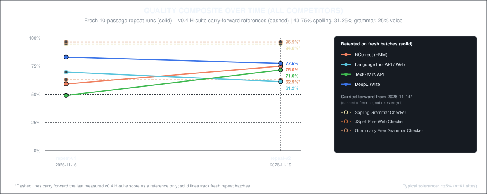
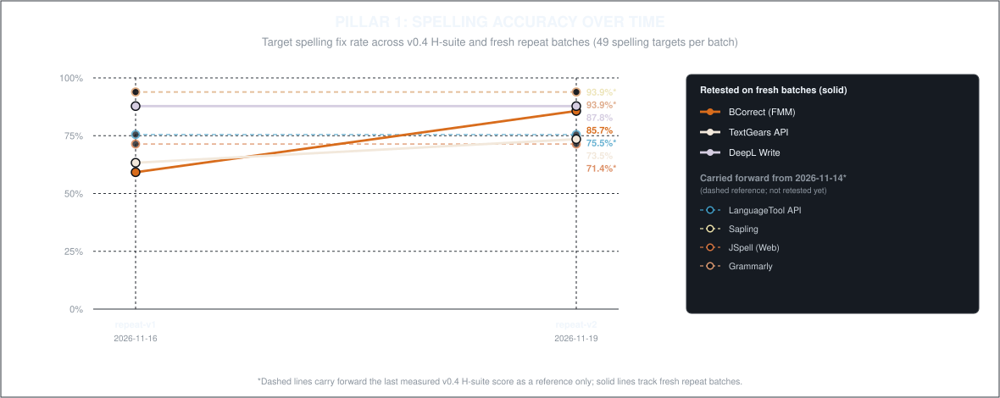
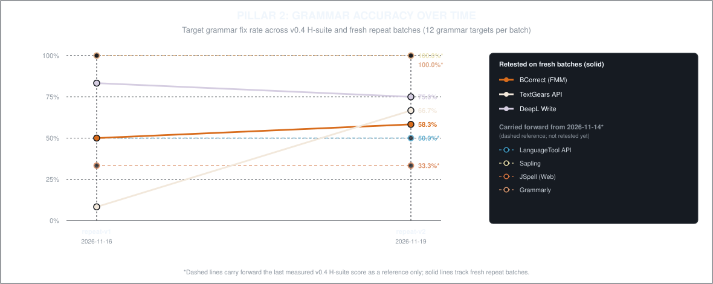
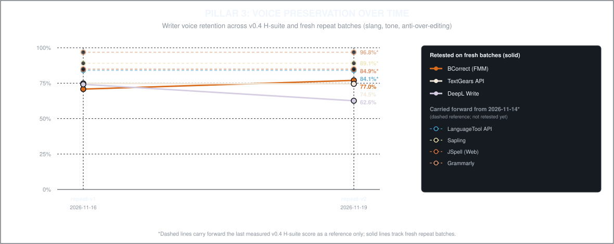
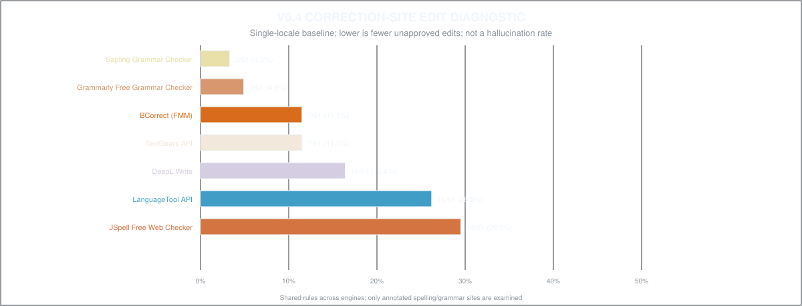

# Voice-Preserving Spellcheck Benchmark

This is an independent, volunteer-run benchmark — not a corporate product or
official certification. We put it together to see how well spelling and grammar
tools fix real mistakes without flattening the writer's voice, slang, or tone.
Anyone can run the scripts locally, poke at the numbers, and check our work.

## Start here

- [How we score](#how-we-score)
- [Results over time & snapshot](#results)
- [Want to help? (Volunteer guide)](CONTRIBUTING.md)
- [Our intent](#our-intent)
- [Next version (v0.5 draft)](#next-version-v05-draft)
- [Documentation index](documentation/README.md)

## How we score

The results below use the v0.4 scoring:

| Pillar | Weight | What it measures |
| --- | ---: | --- |
| Spelling | 43.75% | Did the tool fix the marked spelling mistakes? |
| Grammar | 31.25% | Did the tool fix the marked grammar mistakes? |
| Voice | 25% | Did the tool keep the writer's own words, slang, and style? |
| Unapproved edits | Not scored | How often the tool changed a marked spot to something wrong (shown separately) |

## Results

Writing tools change all the time, and scores can swing noticeably from one set
of passages to the next. Because of that, we lead with **results over time**
rather than treating any single run as a permanent ranking.



*Fresh repeat runs over time (`repeat-v1` → `repeat-v2`, solid) vs. the v0.4 H-suite baseline below (dashed, carried forward from `2026-11-14` for tools not re-run every round).*

<details>
<summary>See per-pillar trends over time (Spelling, Grammar, Voice, Unapproved Edits)</summary>









</details>

### Fresh repeat runs log (`raw_results/h_suite_weekly_history.json`)

| Batch | Date | BCorrect (FMM) | TextGears API | DeepL Write (web) | JSpell |
| :--- | :---: | :---: | :---: | :---: | :---: |
| `h-suite-repeat-v1` | 2026-11-16 | 59.2% | 49.0% | 83.0% | Blocked (API 403) |
| `h-suite-repeat-v2` | 2026-11-19 | 75.0% | 71.6% | 77.5% | Pending web run / API 403 |

*Notes: Each batch uses 10 brand-new passages (49 spelling + 12 grammar targets), so cross-batch moves are descriptive snapshots, not a controlled week-to-week test. TextGears used its `/spelling` endpoint on `v1` and switched to `/correct` (spelling + grammar) starting on `v2`; DeepL Write's `v2` web run defaulted to UK English (`harbour`, `crowd were`).*

### v0.4 H-suite baseline (point-in-time snapshot only)

> **Snapshot notice:** The table and bar chart below are a **single point-in-time snapshot** of the fixed 10-passage v0.4 H-suite (not a permanent ranking — tools update frequently, and the 95% confidence whiskers show how much small sample sizes like `n=12` grammar targets can vary).

| Engine | Spelling | Grammar | Voice | Unapproved edits | Quality composite | Latency |
| :--- | :---: | :---: | :---: | :---: | :---: | :---: |
| **Grammarly** | 93.9% | 100.0% | 96.8% | 3 / 61 (4.9%) | **96.5%** | n/a |
| **Sapling** | 93.9% | 100.0% | 89.1% | 2 / 61 (3.3%) | **94.6%** | n/a |
| **DeepL Write** | 87.8% | 66.7% | 67.1% | 10 / 61 (16.4%) | **76.0%** | n/a |
| **BCorrect (FMM)** | 87.8% | 100.0% | 96.8% | 3 / 61 (4.9%) | **93.9%** | ~681.5 ms |
| **TextGears** | 75.5% | 66.7% | 83.2% | 7 / 61 (11.5%) | **74.7%** | ~974.3 ms |
| **LanguageTool** | 75.5% | 50.0% | 84.1% | 16 / 61 (26.2%) | **69.7%** | ~652.8 ms |
| **JSpell** | 71.4% | 33.3% | 84.9% | 18 / 61 (29.5%) | **62.9%** | n/a |


### Run the benchmark

The benchmark runs offline with zero third-party dependencies and evaluates saved engine outputs:

```bash
# Score the H-suite outputs and display the scorecard
python benchmark_4pillars_hybrid.py

# Regenerate all SVG charts in assets/
python generate_charts.py
```

## Verification and tests

Run the unit test suite with Python 3:

```bash
# Run all unit tests:
python -m unittest discover -s tests -v

# Run the focused v0.5 protocol validation tests:
python -m unittest discover -s tests -p test_benchmark_v05.py -v
```

## Data and privacy

Do not submit private or sensitive text to external writing services. Keep
credentials and personal information out of the repository. The supplemental
spelling-pair file remains under source and reuse review and is not part of the
four-pillar score. The newly drafted v0.5 passage set is dedicated under
CC0-1.0, but its similarity and rights review must be completed before public
release.

## Our intent

This is a small, volunteer-built community project — it doesn't belong to or
serve any one company. We're just trying to measure how writing tools behave on
real, messy human prose. Writers, researchers, and tool makers are all welcome
to open issues, suggest better test passages, or call out where our scoring can
be fairer.

## Next version (v0.5 draft)

v0.5 is still a draft and has no results yet. It proposes four equal pillars
(25% each): spelling, grammar, voice, and negative-control preservation. See
the [v0.5 draft](documentation/benchmark-v0.5-draft.md).

## Legal notes, fair use, and opt-out

- **Open and honest testing:** This benchmark is run in good faith. We have no
  interest in making anyone look bad. We just want to measure how writing tools
  perform on real writing.
- **Fair-use commentary:** We mention product names only to identify the tools
  we test, which we believe is nominative fair use (15 U.S.C. Section
  1125(c)(3)) and fair-use commentary (17 U.S.C. Section 107). Naming a product
  does not mean its maker endorses or sponsors this benchmark.
- **No warranty:** The scripts and scores are provided "as is." Results come from
  a specific test setup and are not a judgment of a tool's overall quality.
  Anyone can run the scripts offline to check our work.
- **Provider opt-out:** If a company does not want their tool tested in future
  rounds, they can open a [Provider opt-out ticket](.github/ISSUE_TEMPLATE/benchmark-opt-out.yml)
  and we will leave them out of future benchmarks. We ask providers to stay so
  the community has transparent data, but we always honor opt-out requests.

For full details, read our
[Collection, Publication, and Legal Policy](documentation/submission-policy.md).

## Licence

The benchmark software and documentation are licensed under Apache-2.0; see
[LICENSE](LICENSE) and [NOTICE](NOTICE). The v0.5 passages and annotations are
separate dataset material dedicated under CC0-1.0; see
[benchmark_data/LICENSE.txt](benchmark_data/LICENSE.txt) and
[its scope notes](benchmark_data/README.md). These data terms do not cover
software, provider outputs, or third-party material.
