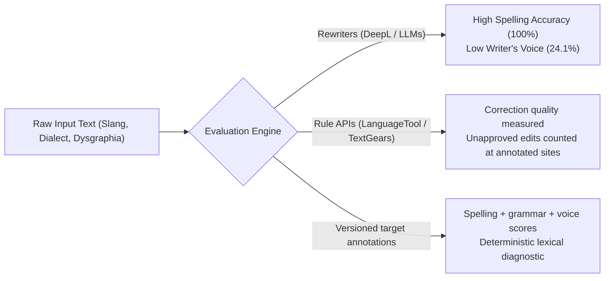
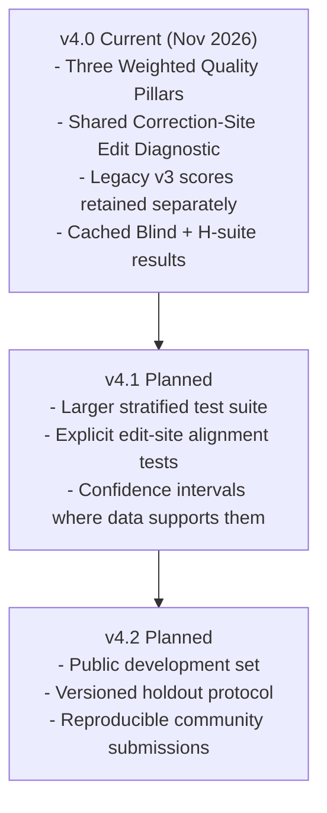

# Benchmark Roadmap & Technical Specification

> **Open Voice-Preserving Benchmark Working Group**  
> *Target Versions: v4.0 (Current) to v4.2 (Planned)*
> *Last Updated: November 2026*

---

## 1. Executive Summary & Mission

The **Voice-Preserving AI-Spellcheck Benchmark** is an open, empirical evaluation suite for spelling, grammar, and preserving the writer's voice. Version 4.0 also reports a deterministic correction-site edit diagnostic; it does not claim to measure hallucinations or semantic correctness.

While historical benchmarks (CoNLL-2014, BEA-2019, JFLEG) evaluated formal academic essays written by second-language learners, modern text generation and grammar-correction tools are deployed on informal, conversational, and technical communication. In these environments, modern Large Language Models (LLMs) and neural rewriters frequently commit **hyper-correction**: replacing authentic slang, dialect, colloquial syntax, and neurodiverse phonetic patterns with sanitized corporate prose.

Our mission is to establish a rigorous, reproducible, vendor-neutral standard that measures the tradeoff between **mechanical correctness** and **authorial voice preservation**.

---

## 2. Release Progression & Architecture

---

## 3. Scoring and Diagnostic Policy (v4.0)

The quality composite contains only spelling (43.75%), grammar (31.25%), and
voice (25%). The v4 correction-site diagnostic is separate and never affects
that composite:

1. Use the same published annotated spelling and grammar sites for every engine.
2. Score spelling and grammar at the annotated source occurrence, not by
   finding an accepted phrase anywhere in the output. Pool accepted target
   hits and applicable targets across the suite.
3. Count an unchanged source as an accuracy hit only when the annotation
   explicitly accepts that source form; identity-only annotations are excluded
   from the target denominator.
4. Align output tokens to input tokens deterministically.
5. Count an applicable diagnostic site as unapproved only when its output is neither
   unchanged nor one of that site's shared accepted correction forms.
6. Report raw unapproved-edit and applicable-site counts, plus their
   percentage. An empty denominator is reported as not applicable.

The Voice scorer remains `lexical-marker-f1-v2`: lexical token F1 outside
correction spans, multiplied by curated voice-marker retention and reduced by
the suite-wide over-edit penalty. This rewards conservative corrections and
dialect adaptation; it was not changed by the target-scoring revision.

This lexical heuristic is inspectable and repeatable, but it does not judge
meaning, inspect unannotated edits, or establish that a correction is
semantically valid. It is not a hallucination rate. No LLM/SLM or human
assessment of engine outputs is used.

---

## 4. Phase Specifications

### Phase 1: Benchmark v4.0 (Current)
- **Cached replay:** `python evaluate_blind_v4.py` scores the Blind suite from saved outputs; `python benchmark_4pillars_hybrid.py` scores the H-suite.
- **Three-pillar quality composite:** Spelling, grammar, and voice are normalized to 100% total weight.
- **Correction-site diagnostic:** Shared accepted correction forms are applied to all systems; raw counts and denominators are reported without semantic or hallucination claims.
- **Versioned results:** v3 results remain in their original files as legacy data and are not compared directly with v4.

### Phase 2: Expanded Deterministic Baselines (v4.1 - Q1 2027)
- Add additional spelling and grammar engines using the same fixed inputs,
  shared annotations, and one-pass collection policy where applicable.
- Collect paired `en-US` and `en-GB` outputs for each participating engine and
  score locale-specific spelling targets against the matching full-passage
  reference. Keep v4.0 single-locale results as a separate baseline; do not
  infer locale support from an unreported setting.
- Publish output schemas, accepted-form annotations, and deterministic scoring
  logic so engine authors can inspect and reproduce each result.
- Do not use language models or human judgments to score engine outputs.

### Phase 3: The Tier-2 Statistical Suite ($N=500+$) (v4.1 - Q2 2027)
To supplement the 10 multi-sentence writing domains (`B-01` to `B-10`), a future version may introduce a larger stratified corpus:
- **Genre Stratification:**
  1. *Youth & Gaming Culture:* Discord banter, Twitch chat, gaming shorthand ($N=100$).
  2. *Regional Dialects:* Appalachian, African American Vernacular English (AAVE), Northern British, Scottish vernacular ($N=100$).
  3. *Pediatric & Neurodiverse Writing:* Clinically documented dysgraphic and dyslexic phonetic samples ($N=100$).
  4. *Developer Communications:* Git commit messages, Pull Request reviews, terminal logs, code comments ($N=100$).
  5. *Creative & Technical Prose:* Specialty domain terminology (coffee cupping, legal, medical, wildlife biology) ($N=100$).
- **Statistical Rigour:** Automated bootstrap resampling ($B=1,000$ iterations) producing 95% confidence intervals and paired Student's t-tests ($p < 0.05$) to establish statistical significance.

### Phase 4: Anti-Contamination Protocol & Live Leaderboard (v4.2 - Q3 2027)
- **Dataset Partitioning:**
  - **Public Development Set (50%):** Openly published in the repository for engine authors to train, validate, and debug their systems.
  - **Private Held-Out Test Set (50%):** Maintained in encrypted storage and refreshed quarterly to evaluate blind generalisation and prevent memorisation.
- **Continuous Evaluation:** A lightweight GitHub Actions test runner and Hugging Face Spaces leaderboard enabling community contributors to submit pull requests with standardized prediction files.

---

## 5. Summary Scoreboard: Blind Suite v4.0

The v4 scorecard uses voice-scoring revision `lexical-marker-f1-v2` and target-scoring revision `aligned-correction-sites-v1`. The quality composite contains spelling (43.75%), grammar (31.25%), and voice (25%). The correction-site diagnostic is separate and not a semantic or hallucination score. Sapling and JSpell were evaluated by accepting their initial suggestions once without rechecking; neither web-demo latency was measured.

| Engine | Spelling | Grammar | Voice | Unapproved edits / sites | Quality composite | Latency |
| :--- | :---: | :---: | :---: | :---: | :---: | :---: |
| **Sapling Grammar Checker** *(web demo; one-pass)* | **★ 93.6%** | **★ 100.0%** | **★ 88.3%** | 0 / 48 (0.0%) | **★ 94.3%** | Not measured |
| **DeepL Write** | 91.5% | **★ 100.0%** | 24.1% | 4 / 48 (8.3%) | 77.3% | ~1,280 ms |
| **TextGears API** | **★ 68.1%** | **★ 100.0%** | 85.2% | 15 / 48 (31.2%) | **★ 82.3%** | ~967 ms |
| **LanguageTool API** | 66.0% | **★ 100.0%** | 64.4% | 16 / 48 (33.3%) | 76.2% | ~677 ms |
| **BCorrect (FMM)** | 63.8% | **★ 100.0%** | **★ 86.6%** | 13 / 48 (27.1%) | 80.8% | ~614 ms |
| **JSpell Free Web Checker** *(one-pass web demo)* | 63.8% | 0.0% | 77.5% | 16 / 48 (33.3%) | 47.3% | Not measured |

The latency column contains recorded client-side response times from cached
requests; it is not a local engine benchmark or a product compute-time
comparison. The Blind and H-suite measurements are separate runs and should
not be compared as if they shared one network session.

The correction-site diagnostic only checks annotated spell/grammar targets. It can miss changes elsewhere and can flag valid output forms absent from the annotations; it must not be interpreted as a hallucination rate. The v3 four-pillar results remain in their original files as legacy data and are not comparable with v4. Stars mark leaders in the score column; the diagnostic is not ranked as quality.

---

## 6. How to Contribute
We welcome engine integrations, test domain contributions, and linguistic annotations. Please consult [`SUBMISSIONS.md`](SUBMISSIONS.md) for data schemas and evaluation submission guidelines.
